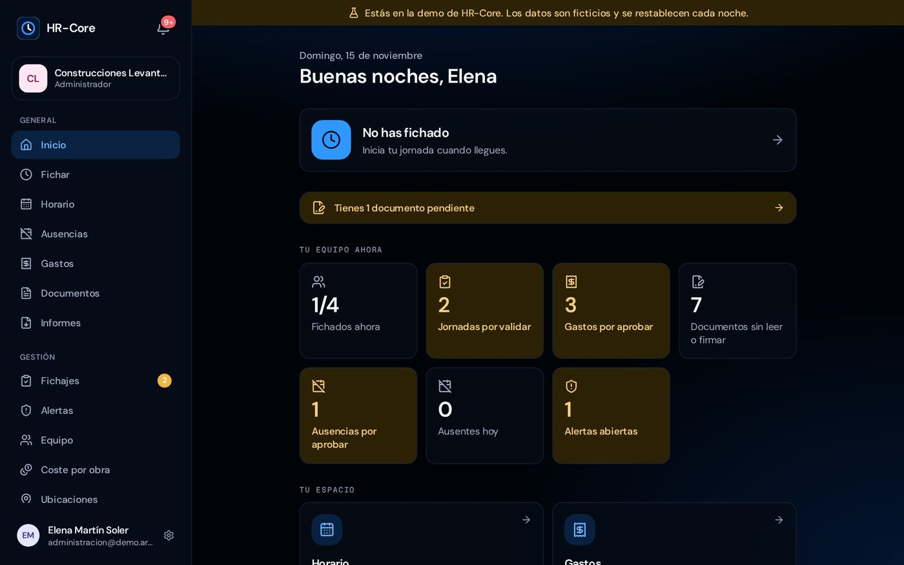
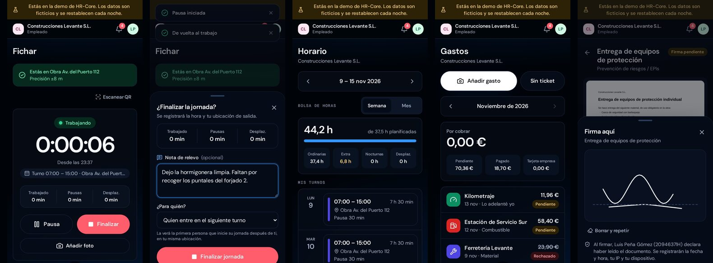
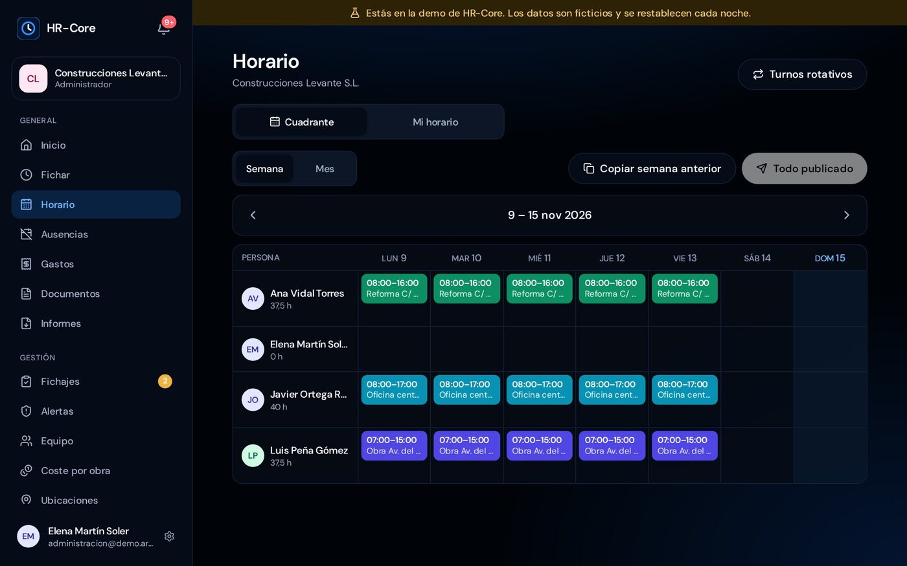
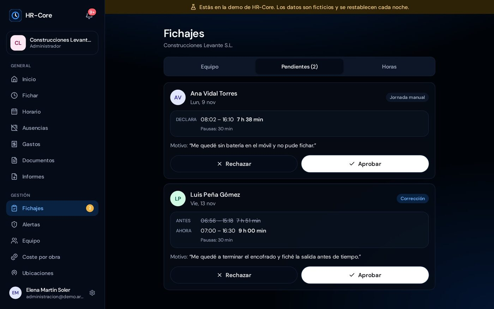
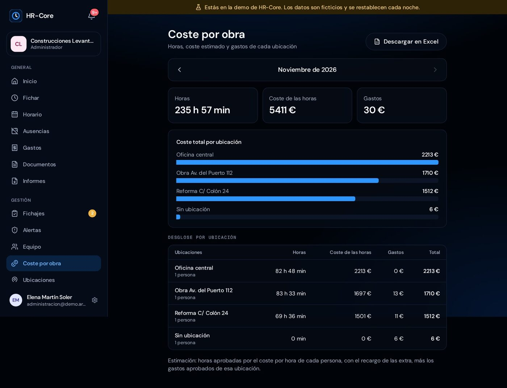

<div align="center">

# HR-Core

**Control horario, cuadrantes, ausencias, gastos y documentos para tu empresa, en tu propio servidor.**

[English](README.md) · **Español**

[](LICENSE)
[](https://github.com/arcode-es/hr-core/actions/workflows/ci.yml)

[Probar la demo](https://arcode.es/HR-core/demo/) · [Documentación](docs/es/README.md) · [Instalar](#instalar)

</div>



HR-Core es una aplicación web que la plantilla usa desde el móvil, sin instalar nada desde una tienda, para fichar
con ubicación, consultar su horario, pedir vacaciones, subir tickets y firmar documentos. Quien coordina valida las
jornadas y organiza el cuadrante, y administración tiene informes, el coste de cada obra y el registro de jornada
que exige la ley.

Se instala con Docker en un servidor tuyo: **los datos de tu plantilla no salen de tu servidor.**

## Funciones



- **Fichaje:** entrada, pausas y salida con comprobación de ubicación; código QR en la entrada; quiosco en una
  tableta con PIN o tarjeta; funciona sin cobertura; foto opcional; correcciones con aprobación y registro de quién
  cambió qué; nota de relevo para el siguiente turno.
- **Horarios:** cuadrante semanal y mensual por centro de trabajo, turnos rotativos y bolsa de horas (ordinarias,
  extra, nocturnas y de desplazamiento).
- **Ausencias:** vacaciones, asuntos propios, bajas y permisos con aprobación, calendario del equipo y festivos.
- **Gastos:** foto del ticket, kilometraje, aprobación y liquidación, imputados a cada obra.
- **Documentos:** contratos y comunicados con firma en el móvil, reparto de nóminas desde un solo PDF y registro de
  jornada mensual para firmar.
- **Gestión:** validación de jornadas, alertas de jornada y descanso, coste por obra, informes en PDF, Excel y CSV y
  archivo mensual para la gestoría.
- **Empresa y privacidad:** marca propia, departamentos, perfiles (empleado, responsable, administración e
  inspección), aviso de geolocalización, plazos de conservación y exportación de datos personales.
- **App instalable** en Android, iPhone, tableta y ordenador, con avisos en el móvil. En español e inglés.

| Cuadrante | Validar jornadas | Coste por obra |
|---|---|---|
|  |  |  |

## Instalar

En un servidor Linux con Docker:

```bash
git clone https://github.com/arcode-es/hr-core.git
cd hr-core
./instalar/instalar.sh
```

El instalador pregunta cómo llegará la plantilla y lo deja todo listo, con copias de seguridad diarias:

- **Con dominio:** `https://fichajes.tuempresa.es`, con HTTPS automático. → [Guía](docs/es/dominio.md)
- **Con Tailscale:** solo dentro de tu red privada, sin exponer nada a internet. → [Guía](docs/es/tailscale.md)
- **En local:** en tu ordenador, para probarlo. → [Inicio rápido](docs/es/inicio-rapido.md)

¿Empiezas de cero con un servidor en la nube? → [Instalar en un VPS](docs/es/vps.md), paso a paso.

| Plantilla | Servidor mínimo |
|---|---|
| Hasta 50 personas | 2 vCPU, 4 GB de RAM, 40 GB SSD |
| Hasta 200 personas | 4 vCPU, 8 GB de RAM, 80 GB SSD |

## Documentación

- [Documentación completa](docs/es/README.md): instalar, [personalizar](docs/es/personalizar.md),
  [gestionar](docs/es/gestionar.md) (copias, actualizaciones, cambiar de servidor) y
  [problemas frecuentes](docs/es/problemas.md).
- Manuales de uso en PDF, para repartir: [trabajadores](docs/manuales/manual-trabajadores.pdf),
  [responsables](docs/manuales/manual-responsables.pdf) y [administración](docs/manuales/manual-administracion.pdf).
- [Desarrollo y arquitectura](docs/es/desarrollo.md).

## ¿Prefieres que lo gestionemos nosotros?

HR-Core es gratis y lo será siempre. Si no quieres ocuparte del servidor, [ARcode](https://arcode.es/HR-core/) lo
instala, lo personaliza con tu marca y lo mantiene por ti: servidor propio para tu empresa, copias, actualizaciones
y soporte, con una cuota mensual según el tamaño de la plantilla.

## Hoja de ruta y comunidad

Mira lo que viene en la [hoja de ruta](ROADMAP.md), pregunta y comparte ideas en [Discussions](https://github.com/arcode-es/hr-core/discussions) y, si quieres ayudar, elige una [incidencia para empezar](https://github.com/arcode-es/hr-core/labels/good%20first%20issue).

## Contribuir

Los avisos de fallos, las ideas, las traducciones y el código son bienvenidos: lee [CONTRIBUTING.md](CONTRIBUTING.md).
Para fallos de seguridad, [SECURITY.md](SECURITY.md).

## Licencia

[AGPL-3.0](LICENSE). Puedes usarlo, modificarlo y desplegarlo libremente en tu empresa. Si ofreces una versión
modificada a otras personas a través de la red, debes publicar su código con la misma licencia.

Los textos legales incluidos (privacidad y aviso legal) son una base pensada para España: revísalos con tu asesoría.

Hecho por [ARcode](https://arcode.es) en Córdoba, España.
