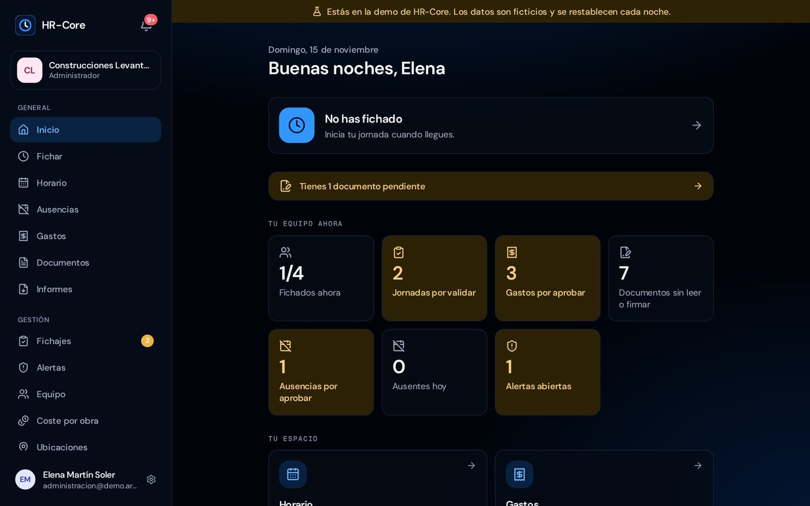
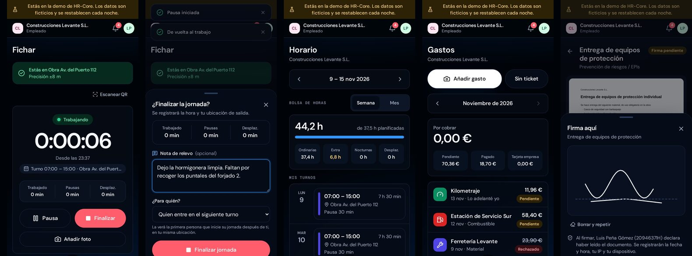
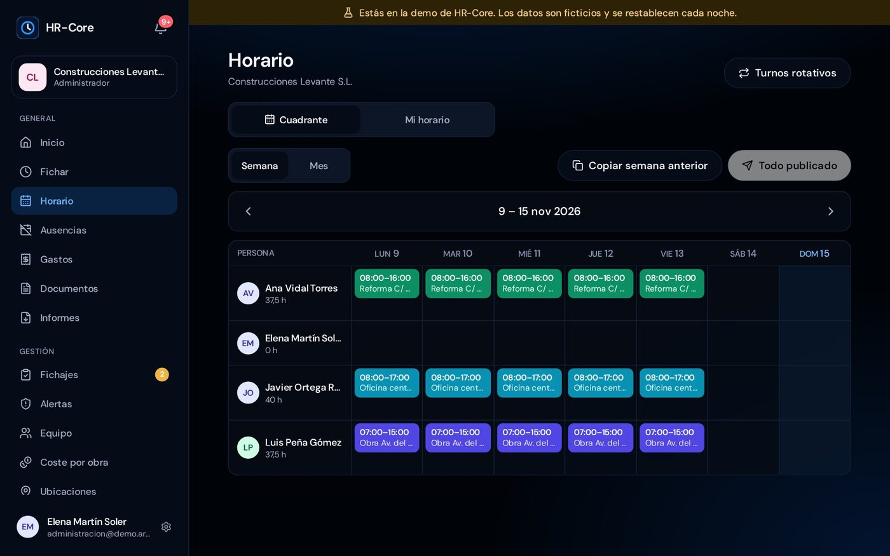
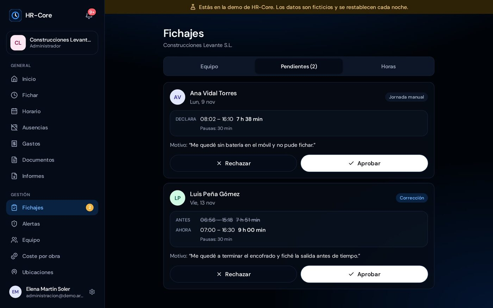
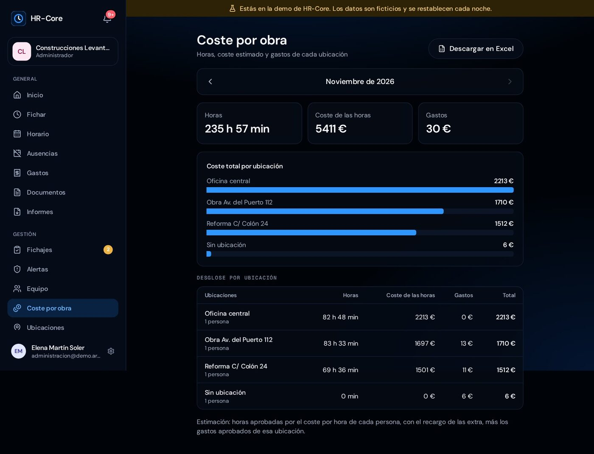

<div align="center">

# HR-Core

**Self-hosted time tracking, rotas, leave, expenses and documents for your company.**

**English** · [Español](README.es.md)

[](LICENSE)
[](https://github.com/arcode-es/hr-core/actions/workflows/ci.yml)

[Live demo](https://arcode.es/HR-core/demo/) · [Documentation](docs/en/README.md) · [Install](#install)

</div>



HR-Core is a web app your staff use from their phones, with no app store needed, to clock in with location, check
their schedule, request time off, upload receipts and sign documents. Managers approve timesheets and plan the
rota, and admins get reports, cost per site and the working-time record required by law.

It runs with Docker on a server you control: **your staff's data never leaves your server.**

> The demo and the PDF user guides are in Spanish; the app itself is available in Spanish and English.

## Features



- **Time tracking:** clock in, breaks and clock out with location checks; QR codes at the entrance; shared tablet
  kiosk with PIN or ID card; works offline; optional photo; approved corrections with a full audit trail; shift
  handover notes.
- **Scheduling:** weekly and monthly rota per site, rotating shift patterns and an hours bank (regular, overtime,
  night and travel hours).
- **Leave:** holidays, personal days, sick leave and paid leave with approval, team calendar and public holidays.
- **Expenses:** receipt photos, mileage, approval and settlement, allocated to each site.
- **Documents:** contracts and notices signed on the phone, payslips split from a single PDF, monthly time record
  ready to sign.
- **Management:** timesheet approval, working-time and rest alerts, cost per site, PDF/Excel/CSV reports and a
  monthly export for your payroll provider.
- **Company and privacy:** your own branding, departments, roles (employee, manager, admin, inspector), geolocation
  notice, retention periods and personal data export (GDPR).
- **Installable app** on Android, iPhone, tablets and desktop, with push notifications. In Spanish and English.

| Rota | Timesheet approval | Cost per site |
|---|---|---|
|  |  |  |

## Install

On a Linux server with Docker:

```bash
git clone https://github.com/arcode-es/hr-core.git
cd hr-core
./instalar/instalar.sh
```

The installer asks how your staff will reach it and sets everything up, including daily backups:

- **With a domain:** `https://time.yourcompany.com`, with automatic HTTPS. → [Guide](docs/en/domain.md)
- **With Tailscale:** only inside your private network, nothing exposed to the internet. → [Guide](docs/en/tailscale.md)
- **Local:** on your own computer, to try it out. → [Quick start](docs/en/quick-start.md)

Starting from scratch with a cloud server? → [Install on a VPS](docs/en/vps.md), step by step.

| Staff | Minimum server |
|---|---|
| Up to 50 people | 2 vCPU, 4 GB RAM, 40 GB SSD |
| Up to 200 people | 4 vCPU, 8 GB RAM, 80 GB SSD |

## Documentation

- [Full documentation](docs/en/README.md): install, [customize](docs/en/customize.md),
  [manage](docs/en/manage.md) (backups, updates, moving servers) and [troubleshooting](docs/en/troubleshooting.md).
- PDF user guides to hand out (in Spanish): [staff](docs/manuales/manual-trabajadores.pdf),
  [managers](docs/manuales/manual-responsables.pdf) and [admins](docs/manuales/manual-administracion.pdf).
- [Development and architecture](docs/es/desarrollo.md) (in Spanish).

## Rather have it managed for you?

HR-Core is free and always will be. If you would rather not run a server, [ARcode](https://arcode.es/HR-core/)
installs it, brands it for your company and runs it for you: a dedicated server for your company, backups, updates
and support, for a monthly fee based on team size.

## Contributing

Bug reports, ideas, translations and code are welcome: see [CONTRIBUTING.md](CONTRIBUTING.md). For security
issues, see [SECURITY.md](SECURITY.md).

## License

[AGPL-3.0](LICENSE). You can use, modify and deploy it freely in your company. If you offer a modified version to
others over a network, you must publish its source under the same license.

The bundled legal texts (privacy policy and legal notice) are a starting point written for Spain; adapt them to your
local law with an adviser.

Made by [ARcode](https://arcode.es) in Córdoba, Spain.
